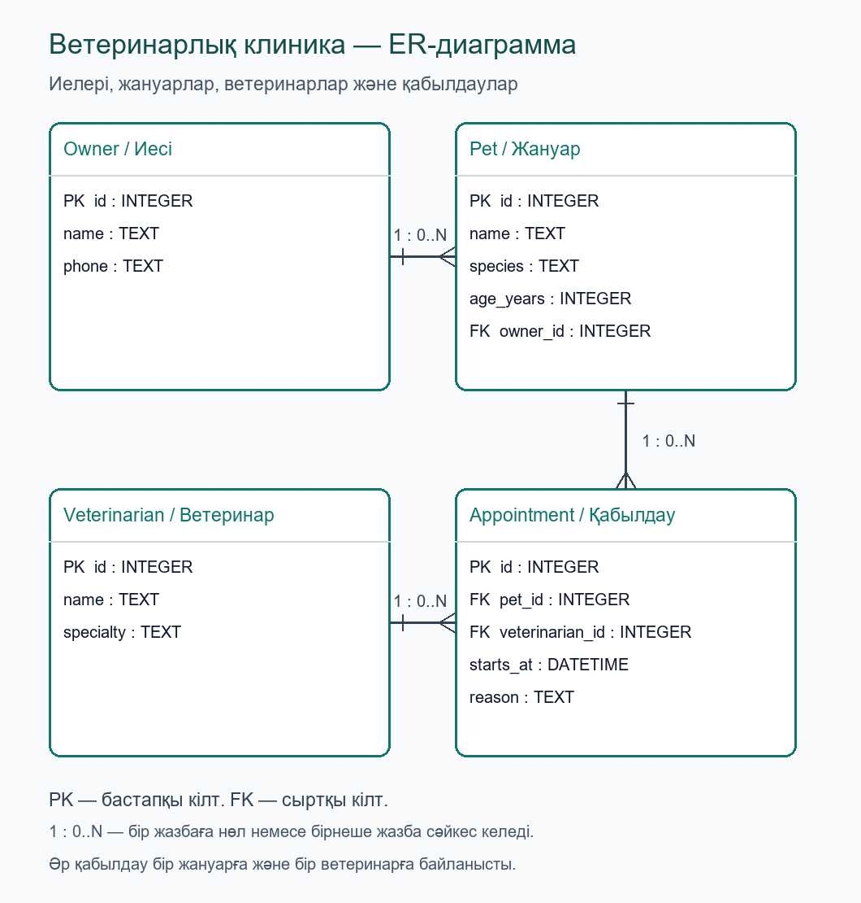

# Ветеринарлық клиникадағы қабылдауларды есепке алу

Зертханалық жұмыс №1. Python тілінде жасалған ветеринарлық клиниканың ақпараттық жүйесі. Жоба жануар иелерін, жануарларды, ветеринарларды тіркейді және қабылдауға жазады.

Репозиторий: [nursayaya1/applied-is-project-2026](https://github.com/nursayaya1/applied-is-project-2026).

## Мүмкіндіктері

- Иесін аты-жөні және телефонымен тіркеу.
- Жануардың атын, түрін, толық жасын және иесін сақтау.
- Ветеринардың аты-жөні мен мамандануын сақтау.
- Жануарды ветеринарға күнін, уақытын, келу себебін көрсетіп жазу.
- Қабылдауларды уақыт ретімен көру және төрт бөлімдегі жазба санын есептеу.
- Бір ветеринарды немесе бір жануарды дәл бір уақытқа қайта жазуды бұғаттау (HTTP 409).

## ER-диаграмма



| Байланыс | Мағынасы |
|---|---|
| Owner → Pet | Бір иеде нөл немесе бірнеше жануар болады; әр жануардың бір иесі бар. |
| Pet → Appointment | Бір жануардың нөл немесе бірнеше қабылдауы болады. |
| Veterinarian → Appointment | Бір ветеринар нөл немесе бірнеше қабылдау өткізеді. |

Әр қабылдау бір жануарға және бір ветеринарға байланысты. `id` — бастапқы кілт (PK). `owner_id`, `pet_id`, `veterinarian_id` — сыртқы кілттер (FK).

[Өңделетін draw.io файлы](docs/er-diagram.drawio): [draw.io](https://app.diagrams.net/) → **File → Open from → Device**. PNG экспорттау: **File → Export as → PNG**.

## Архитектура және құрылым

Пайдаланушы → Streamlit → HTTP → FastAPI → SQLModel → SQLite.

```text
app/
  main.py                 # FastAPI қолданбасы, іске қосу, /health
  api/routes.py           # Төрт нысанға GET және POST маршруттары
  models/clinic.py        # Owner, Pet, Veterinarian, Appointment модельдері
  db/session.py           # SQLite қосылымы және сессиялар
frontend/app.py           # Қазақша Streamlit интерфейсі
docs/
  er-diagram.png          # ER-диаграмма
  er-diagram.drawio       # Өңделетін сызба
  GUIDE_KK.md             # Толық қазақша түсіндірме
scripts/
  create_diagram.py       # PNG және draw.io сызбасын жасау
  smoke_check.py          # API және UI іске қосылуын тексеру
tests/                   # API және интерфейс тесттері
.vscode/                 # Python ортасының баптаулары
.gitignore               # Git-ке кірмейтін файлдар
requirements.txt         # Негізгі кітапханалар
requirements-dev.txt     # Тест кітапханалары
requirements-lock.txt    # Тексерілген нақты нұсқалар
```

SQLite дерекқоры `vet_clinic.db` файлына жазылады және сервер алғаш іске қосылғанда жасалады. Әр қабылдаудың уақыты Asia/Qyzylorda жергілікті уақыты ретінде, минут дәлдігімен сақталады. API мысалы: `2026-11-10T10:00:00` (уақыт белдеуінің жұрнағынсыз).

## Іске қосу

Осы компьютерде `venv` және кітапханалар дайын. VS Code-та жоба папкасын ашыңыз. Бұрынғы серверлер ашық болса, әр терминалда **Ctrl+C** басып тоқтатып, қайта қосыңыз.

Бірінші PowerShell терминалы:

```powershell
.\venv\Scripts\python.exe -m uvicorn app.main:app --reload
```

Екінші PowerShell терминалы:

```powershell
.\venv\Scripts\python.exe -m streamlit run frontend/app.py
```

- Интерфейс: http://localhost:8501
- Swagger: http://127.0.0.1:8000/docs
- Сервер күйі: http://127.0.0.1:8000/health

Жаңа компьютерге орнату (Python 3.12 ұсынылады):

```powershell
git clone https://github.com/nursayaya1/applied-is-project-2026.git
cd applied-is-project-2026
python -m venv venv
.\venv\Scripts\python.exe -m pip install -r requirements.txt
```

Нақты тексерілген нұсқалар үшін `requirements-lock.txt` қолдануға болады. Виртуалды ортаны белсендіру міндетті емес: командалар оның Python-ын тікелей шақырады. Қажет болса, активация: `.\venv\Scripts\Activate.ps1`.

## Демо сценарий

1. **Иелері:** Айгүл, телефон: `+7 700 000 00 00` (оқу мысалы).
2. **Жануарлар:** Марғау, Мысық, 2 жас, иесі — Айгүл.
3. **Ветеринарлар:** Дана, мамандануы — Жалпы практика.
4. **Қабылдаулар:** Марғау → Дана, күн мен уақытты таңдаңыз, келу себебі — Жоспарлы тексеру.
5. Қабылдау тізімге түседі; алғаш енгізгенде төрт көрсеткіштің әрқайсысы 1 болады.

## API

| Әдіс | Мекенжай | Қызметі |
|---|---|---|
| GET | `/health` | Сервер күйі |
| GET / POST | `/api/owners` | Иелер тізімі / иесін тіркеу |
| GET / POST | `/api/pets` | Жануарлар тізімі / жануар тіркеу |
| GET / POST | `/api/veterinarians` | Ветеринарлар тізімі / ветеринар тіркеу |
| GET / POST | `/api/appointments` | Қабылдаулар тізімі / қабылдауға жазу |

POST `/api/appointments` мысалы (ID=1 жануар мен ветеринар алдын ала тіркелуі тиіс):

```json
{"pet_id":1,"veterinarian_id":1,"starts_at":"2026-11-10T10:00:00","reason":"Жоспарлы тексеру"}
```

Қосу сәтті болса — 201; байланыстырылатын нысан жоқ болса — 404; бір уақытқа қайталап жазылса — 409; өріс қате болса — 422.

## Тексеру

```powershell
.\venv\Scripts\python.exe -m pip install -r requirements-dev.txt
.\venv\Scripts\python.exe -m pytest -q
.\venv\Scripts\python.exe scripts/smoke_check.py
```

API тесттері бөлек жедел жад дерекқорын қолданады. Интерфейс тесті жасанды оқу деректерін қолданады. Smoke тексерісі негізгі дерекқорда кестелерді жасайды, бірақ жазбалар қоспайды; уақытша серверлерін өзі тоқтатады.

2026-11-03: 12 тест сәтті өтті; API, Swagger және Streamlit серверінің іске қосылуы тексерілді.

## Оқу жобасының шекарасы

Бұл №1 зертханаға арналған бастапқы жүйе. Қосу және тізімдеу іске асырылған. Өңдеу, жою, авторизация, емдеу картасы және төлем есебі жоқ. Қабылдау ұзақтығы сақталмайды: тек бірдей басталу уақытының қайталануы тексеріледі. Өткен күнге жазба енгізуге болады.

VS Code-та Python және GitHub Copilot ұсынылған. ИИ аккаунтына кіруді өзіңіз орындайсыз. Файлдардың мағынасы, ИИ промпті және қорғауға дайындық: [қазақша нұсқаулық](docs/GUIDE_KK.md).

## Құжаттар

- [FastAPI және SQL дерекқорлары](https://fastapi.tiangolo.com/tutorial/sql-databases/)
- [Streamlit іске қосу](https://docs.streamlit.io/get-started/installation/command-line)
