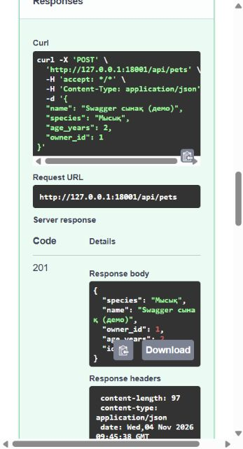

# Зертханалық жұмыс 3 — FastAPI GET және POST

Төрт нысанның әрқайсысында тізім, ID арқылы іздеу және қосу маршруттары бар. Негізгі файл — `app/main.py`, роутер — `app/api/routes.py`.

```powershell
.\venv\Scripts\python.exe seed.py
.\venv\Scripts\python.exe -m uvicorn app.main:app --reload
```

Тапсырмадағы `http://127.0.0` мекенжайы толық емес. Дұрыс мекенжайлар: сервер — http://127.0.0.1:8000/, Swagger — http://127.0.0.1:8000/docs.

## Маршруттар

`/api/owners`, `/api/pets`, `/api/veterinarians`, `/api/appointments` үшін GET тізімді, POST жаңа жазбаны береді. GET `/api/pets/{record_id}` сияқты маршрут бір жазбаны табады; ID жоқ болса HTTP 404.

`Depends(get_session)` әр сұранысқа дерекқор сессиясын береді. `with Session(engine)` сессияны ашады, `yield` оны маршрутқа береді, сұраныс біткен соң контекст сессияны жабады. Жазбаны сақтау кезінде commit, кейін refresh орындалады.

Create схемаларында `id` жоқ. `extra="forbid"` клиент жіберген артық өрістерді 422 арқылы қайтарады. Мысалы, клиент жаңа жазбаға `id: 500` тағайындай алмайды.

## Swagger арқылы қолмен тексеру

1. `/docs` ашыңыз. GET `/api/owners` → **Try it out → Execute**. Демо иелердің нақты ID нөмірлерін қараңыз.
2. GET `/api/pets` орындап, бір жануардың ID нөмірін алыңыз. GET `/api/pets/{record_id}` арқылы оны табыңыз.
3. POST `/api/pets` үшін төмендегі мысалда `owner_id` орнына өз базаңыздағы ID қойыңыз:

```json
{"name":"Бөрте","species":"Ит","age_years":-1,"owner_id":1}
```

4. Теріс жас 422 қайтаруы керек. Жасын 3 деп түзетіп, қайта орындаңыз — 201 және жаңа ID келеді.
5. ID=999999 үшін GET орындаңыз — 404. Жоқ иесінің ID нөмірімен жануар жасау — 404.

API тесті Swagger-дегі әрекеттің баламасын тексереді, бірақ оқытушыға Try it out арқылы орындауды өзіңіз көрсетіңіз.

2026-11-04 күні Swagger-де нақты тексерілді: `search=МАРҒА` → 200; POST теріс жаспен → 422; түзетілген POST → 201. Тексеру уақытша 18001 портында жүргізілді; әдеттегі іске қосу порты — 8000. Уақытша сынақ жазбасы кейін жойылды.



## ИИ промпті және қорғау

> Ветеринарлық клиника FastAPI жобасында Depends(get_session) арқылы GET тізім, GET ID, POST маршруттарын тексер. Create схемасында id қабылданбасын. Жоқ жазба 404, қате мәлімет 422, сәтті қосу 201 қайтарсын.

GET мәлімет оқиды, POST жаңа жазба жасайды. Валидация маршрут орындалмай тұрып кіріс схемасына қарай жасалады. 404 — ресурс жоқ, 422 — жіберілген мәлімет қате.
