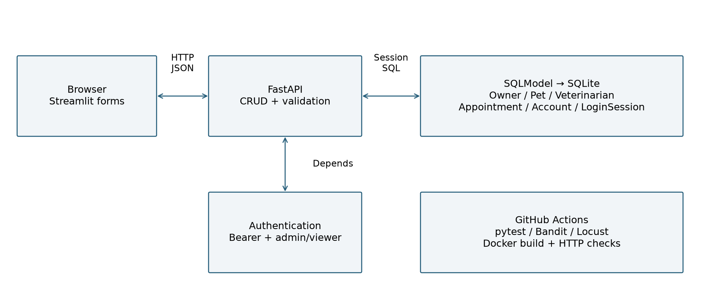
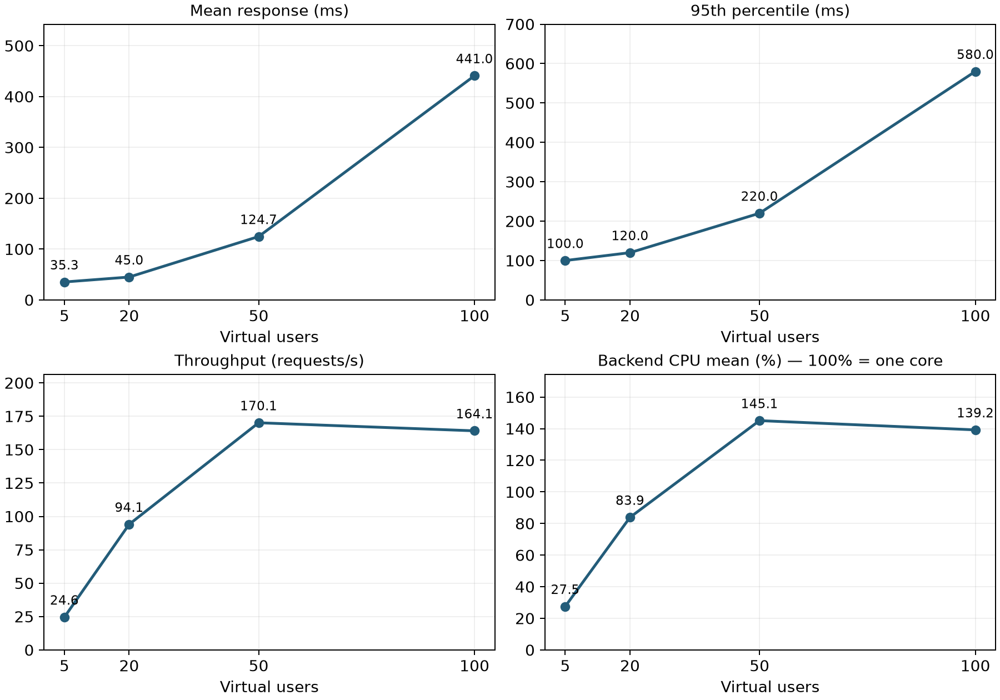
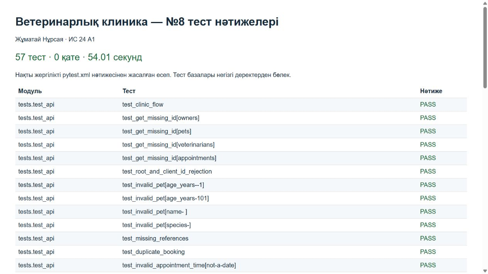
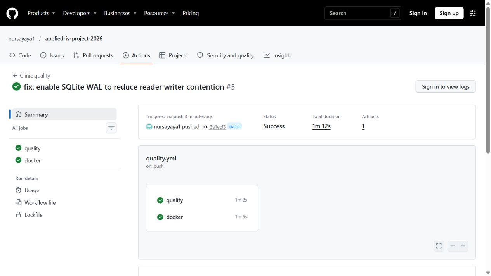

# Зертханалық жұмыс 8

Интеграциялық және жүктемелік сынақтар, қауіпсіздік аудиті және GitHub Actions арқылы сапаны бақылау

Пәні: Ақпараттық жүйелердің қолданбалы бағдарламалық жасақтамасы

Орындаған: Жұматай Нұрсая
Тобы: ИС 24 А1
Орындау кезеңі: 17–18 қараша 2026

## Жұмыстың мақсаты

№7-де жасалған ветеринарлық клиника жүйесінің компоненттерін бірге тексеру, жоғары жүктемедегі ақауды анықтап түзету және қайталанатын тексерістерді GitHub Actions арқылы автоматтандыру.

## Негізгі нәтиже

57 автоматты тест және 14 нақты HTTP сценарийі өтті. Жүктемелік сынақ 100 пайдаланушыда QueuePool қосылым шегінің толуын анықтады. SQLite қосылымдары NullPool арқылы басқарылып, WAL режимі қосылды. Түзетуден кейін төрт сценарий қайта орындалды; 100 пайдаланушыда 29505 сұраныс және 0 қате тіркелді.

## Қолданылған құралдар

Python 3.12.14, FastAPI, SQLModel, SQLite, Streamlit, Requests, pytest, Locust 2.47.0, Bandit, psutil, GitHub Actions және Docker Compose. Жергілікті өлшеу: Windows 11, 6 логикалық CPU. Docker Ubuntu GitHub runner ішінде тексерілді.

Репозиторий: https://github.com/nursayaya1/applied-is-project-2026

## Ақпараттық жүйенің архитектурасы

Streamlit формалары HTTP арқылы FastAPI-ге сұраныс береді. Bearer сессиясы мен рөл тексерілген соң API SQLModel сессиясын пайдаланып SQLite-ға қатынайды. Негізгі төрт кестеге Account және LoginSession қосылды; Account → LoginSession байланысы бірден көпке.

| Компонент | Екі ықтимал қате | Интеграциялық тексеру |
| --- | --- | --- |
| Streamlit | API қолжетімсіз; 204 жауапты JSON деп оқу | UI ↔ API, AppTest |
| FastAPI сервері | Сервер басталмайды; DB сессиясы ашылмайды | Startup және health checks |
| API интерфейстері | Жоқ ID; қате өрістер/JSON | GET/POST/PUT/PATCH/DELETE |
| SQLite және ORM | FK/NOT NULL бұзылуы; pool толуы | Rollback және қатарлас HTTP |
| Аутентификация | Қате пароль; мерзімі өткен сессия | Login → protected API → logout |
| Рөлдер және қауіпсіздік | Viewer өзгертуі; құпияны қате жауабында қайталау | 403 және құпияның болмауы |
| CI және Docker | Тест өтпеуі; сервис іске қосылмауы | Quality және docker jobs |

## API интеграциялық тестілеу нәтижелері

scripts/run_http_checks.py уақытша файлдық база мен нақты Uvicorn серверін іске қосады. Python requests арқылы жіберілген сұраулардың статус-коды, жауап мазмұны және күтілетін нәтижесі http-results.json ішінде сақталады. Негізгі база өзгертілмейді.

| Сценарий | Күтілген | Нақты |
| --- | --- | --- |
| Read seed data | 200 | 200 |
| Create | 201 | 201 |
| Read created | 200 | 200 |
| Full replacement | 200 | 200 |
| Read updated | 200 | 200 |
| Delete | 204 | 204 |
| Read deleted | 404 | 404 |
| Empty input | 422 | 422 |
| Malformed JSON | 400 | 400 |
| Unknown identifier | 404 | 404 |
| Without authorization | 401 | 401 |
| Wrong login | 401 | 401 |
| Literal SQL injection search | 200 | 200 |
| Concurrent reads | 200 | 200 |

## Деректер қоры және транзакция

POST жазба құрады, GET қайта оқиды, PUT толық өзгертеді, DELETE жояды. ORM тесті API өзгерісінің базаға сақталғанын жеке Session арқылы тексереді. Қатарлас регрессиялық сынақта 50 worker арқылы 100 GET жіберіліп, барлығы 200 қайтарды.

Rollback тестінде бір транзакцияға жарамды Owner және name=None болатын жарамсыз Pet енгізілді. Дерекқор NOT NULL шектеуі IntegrityError тудырды. session.rollback() орындалған соң екі кестеде де жаңа жазба қалмады. Одан кейін жарамды Owner сақталып, сессияның қайта жұмыс істейтіні тексерілді.

## Жүктемелік тестілеу нәтижелері

Түзетуден кейінгі толық өлшеу. Әр виртуалды пайдаланушы 0.2–0.8 секунд кідіреді. Сценарий салмақтары: 4 рет тізімдерді оқу, 2 рет сүзу, 1 рет жеке жазбаны қосу/PUT/жою. Логин алдын ала орындалады; оның құны бұл өлшеуге кірмейді.

| Users | Секунд | Сұраныс | Қате % | Орташа ms | p95 ms | RPS |
| --- | --- | --- | --- | --- | --- | --- |
| 5 | 60 | 1462 | 0.00 | 35.3 | 100 | 24.6 |
| 20 | 120 | 11224 | 0.00 | 45.0 | 120 | 94.1 |
| 50 | 180 | 30459 | 0.00 | 124.7 | 220 | 170.1 |
| 100 | 180 | 29505 | 0.00 | 441.0 | 580 | 164.1 |

50 → 100 пайдаланушы: орташа уақыт 124.7 → 441.0 ms, p95 220 → 580 ms, RPS 170.1 → 164.1. Бұл бір компьютердегі бір реттік өлшеу; өндіріске арналған сыйымдылық кепілі емес.

## Ресурстар және табылған ақау

| Пайдаланушы | CPU орташа % | CPU максимум % | RAM максимум MB |
| --- | --- | --- | --- |
| 5 | 27.5 | 44.8 | 79.1 |
| 20 | 83.9 | 119.1 | 82.9 |
| 50 | 145.1 | 177.6 | 90.3 |
| 100 | 139.2 | 172.2 | 102.5 |

CPU — backend процесі мен оның бала процестерінің жиынтығы; 100% бір логикалық ядроға тең. RAM — сол процестердің RSS жиынтығы. Locust процесі бұл мәндерге кірмейді, бірақ сол компьютерде жұмыс істейді. Фондық қолданбалар мен есеп дайындау өлшеуге әсер етуі мүмкін; CPU мен MB әртүрлі өлшем болғандықтан оларды тікелей салыстыруға болмайды.

100 пайдаланушыда backend CPU орташа 139.2% болды, RAM шыңы 102.5 MB. CPU динамикасын және SQL күту уақытын профильдеу орынды; бұл өлшеу бүкіл компьютер ресурстары таусылды дегенді білдірмейді.

## Ақау және түзету

Бастапқы 100 пайдаланушылық сынақтың CSV есебі: 360 сұраныс, 282 қате, орташа 42859.4 ms. CSV мен console жиынтығы shutdown кезіндегі соңғы сұраныстарға байланысты аздап ерекшеленеді; бұл есеп CSV-ді қолданады. Бастапқы деректер load-before/raw ішінде сақталған.

45 секундтық қайталау ақаудың себебін сервер журналында дәлелдеді: QueuePool limit of size 5 overflow 10 reached, timeout 30.00. Бұл жай ғана «сервер баяу» деген жорамал емес; diagnostic/users_100_server.log ішінде нақты exception бар.

Түзету: файлдық SQLite үшін poolclass=NullPool және 10 секундтық SQLite busy timeout. Келесі сынақта database is locked қатесі байқалғандықтан, init_db ішінде PRAGMA journal_mode=WAL қосылды. Бұл оқырмандар мен жазушының қатар жұмысын жақсартты; SQLite бір уақытта бір жазушыға ғана рұқсат береді. Сессия жабылғанда қосылым қайтарылады/жабылады; шағын QueuePool кезегін күту жойылады. Бұл PostgreSQL үшін жалпы ұсыныс емес, осы SQLite жүйесіндегі түзету.

Қайта өлшеуде 100 пайдаланушы: 29505 сұраныс, 0 қате. Өсетін жүктеме үшін келесі қадамдар: pagination, сұрауларға сәйкес индекстер, PostgreSQL және жеке серверде бірнеше қайталама өлшеу. Бір worker/SQLite шектеуі есепте сақталады.

## Қауіпсіздік және автоматты тесттер

| Сценарий | Нәтиже |
| --- | --- |
| Бос пароль | Login 422; аккаунт жасау саясаты қабылдамайды |
| Әлсіз пароль | 12 таңба/регистр/сан/символ саясаты ValueError береді |
| Қате логин немесе пароль | 401; бірдей жалпы хабарлама |
| Авторизациясыз GET | 401 және WWW-Authenticate: Bearer |
| Viewer POST/PUT/PATCH/DELETE | 403; база өзгермейді |
| Жарамсыз JSON | 400; raw input жауапта қайталанбайды |
| Мерзімі өткен не қайтарылған токен | 401 |
| SQL injection тәрізді іздеу | Қалыпты мәтін ретінде қаралады; кесте сақталады |
| Құпияның жауап/логта көрінуі | Тест паролі response және caplog ішінде жоқ |

pytest: 57 passed, 0 failures, 0 errors. Тесттер қалыпты, шекаралық және қате енгізу жағдайларын қамтиды. TestClient/httpx deprecation ескертуі бар; бұл failed test емес. Bandit app және frontend модульдерін қарап, 0 finding қайтарды; бұл осалдық жоқ деген толық кепіл емес.

Шектеулер: HTTPS reverse proxy, brute-force rate limit, парольді қалпына келтіру және қауіпсіздікке маманданған сыртқы аудит жоқ. Жүйе localhost оқу демонстрациясына арналған. Құпиясөздер мен нақты bearer токендері есепке және GitHub-қа енгізілмейді.

## CI нәтижелері және қорытынды

Workflow әр push/pull request кезінде pytest, Bandit, нақты HTTP және қысқа Locust сынағын орындайды. Docker job backend пен frontend образдарын құрып, health, авторизация және CRUD тексерістерін өткізеді. Продакшнға автоматты жариялау жасалмайды.

NullPool және WAL түзетуінен кейін: success. [Run 44156597694](https://github.com/nursayaya1/applied-is-project-2026/actions/runs/44156597694)

Қалыпты режимде қайта тексеру: success. [Run 44153812651](https://github.com/nursayaya1/applied-is-project-2026/actions/runs/44153812651)

Әдейі қате тәжірибесі: failure. [Run 44153412878](https://github.com/nursayaya1/applied-is-project-2026/actions/runs/44153412878)

Әдейі сәтсіз тәжірибеде уақытша test_intentional_lab_failure ішінде assert 200 == 201 орындалды. Тек осы қадам failed болды. demonstrate_failure=false арқылы қайта іске қосқанда қалыпты тексеріс жасыл аяқталды; негізгі қолданба коды бұл жаттығуда өзгермеді.

Қорытынды: авторизациясыз қолжетімділік жабылды, рөлдер серверде тексеріледі, транзакция rollback арқылы қорғалды. Жүктемелік сынақ нақты қосылым ақауын анықтап, түзетуден кейін қайта өлшенді. Бастапқы және соңғы CSV, pytest XML, HTTP JSON, Bandit JSON және CI скриншоттары репозиторийде сақталды.

Тапсырма дереккөзі: https://chatgpt.com/s/t_6af4005ed7f88191a5fabf3cf1cedc50

SQLAlchemy анықтамасы: https://docs.sqlalchemy.org/en/20/dialects/sqlite.html

Қорғау реті: docs/LAB_08_KK.md. Негізгі дәлелдер: pytest.xml, http-results.json, bandit.json, load/summary.json және GitHub Actions run сілтемелері.
